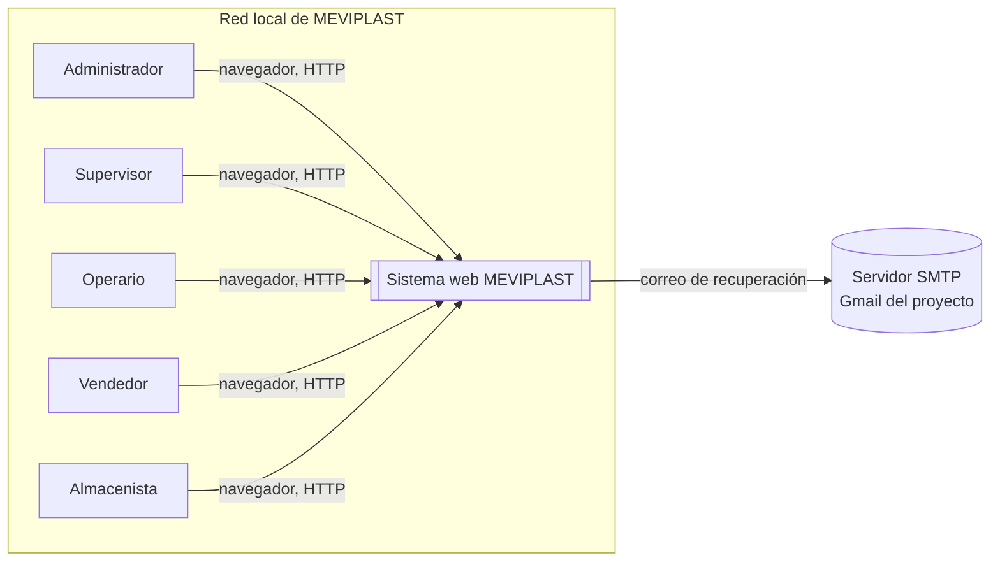
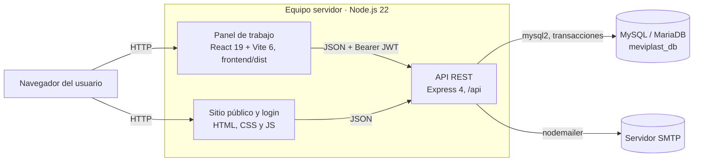
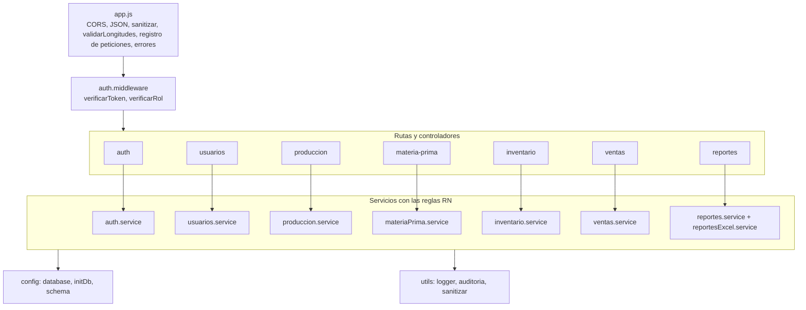
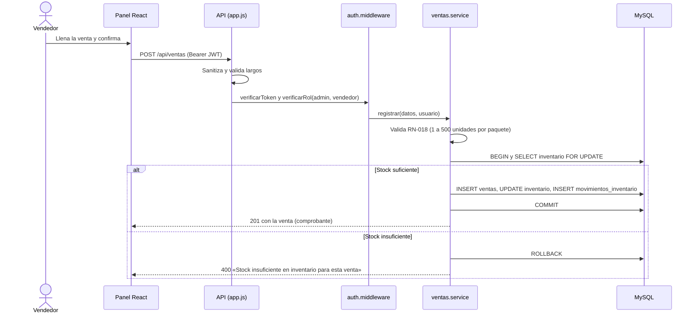
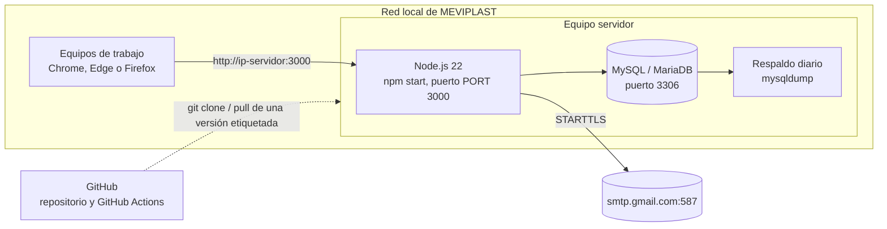

# Diagramas de arquitectura

Fuentes editables de los diagramas del documento «Arquitectura, Datos y Diseño Técnico» (MEV-DOC-06). GitHub los dibuja a partir de los bloques Mermaid; para cambiarlos se edita el texto. Describen el código de `develop`. El modelo de datos (DIA-006) está en [`../data/er.md`](../data/er.md).

## DIA-001 · Contexto

## DIA-002 · Contenedores

## DIA-003 · Componentes de la API

## DIA-004 · Secuencia: registrar una venta (RF-020, RF-021)

## DIA-005 · Despliegue

