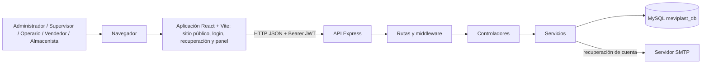

# Arquitectura

## Vista de contexto

La API también genera los comprobantes de venta (datos que el panel imprime) y los reportes en Excel (`exceljs`, en `reportesExcel.service.js`). En cada petición protegida, `verificarToken` comprueba la firma del token y que el usuario siga activo y con el mismo rol (ADR-004).

En desarrollo, Vite sirve el panel y proxifica `/api` al puerto `PORT` de `backend/.env` (por defecto 3000). En ejecución compilada, Vite genera `frontend/dist` y Express publica solo esa carpeta: la página base, los paquetes compilados y las imágenes. Las direcciones `/`, `/login.html`, `/recuperar.html` y `/dashboard.html` abren la misma aplicación, que carga la página que corresponde; cualquier otra dirección responde 404. El código fuente, `package.json`, `node_modules` y la configuración del frontend no se publican (DEF-028).

Los diagramas de contexto, contenedores, componentes, secuencia de una venta y despliegue están en [`diagramas.md`](diagramas.md).

## Capas

- `backend/src/routes`: endpoints y middleware de rol.
- `backend/src/controllers`: validación HTTP y respuestas.
- `backend/src/services`: consultas y reglas del dominio.
- `backend/src/config`: conexión e inicialización de MySQL.
- `frontend/src`: aplicación React. `DashboardApp.jsx` maneja la sesión, el menú por rol, la carga de datos y las confirmaciones; `comun/` reúne las constantes, el formato, el cliente de la API, las validaciones y los componentes compartidos; `vistas/` tiene un archivo por pantalla.
- `frontend/src/paginas`: una página por dirección (sitio público, inicio de sesión, recuperación de cuenta y el panel); `main.jsx` elige cuál cargar.
- `frontend/public/assets`: imágenes que se copian tal cual al build (el logo también lo usan los PDF del backend).

## Decisiones relacionadas

La elección de Node.js y Express en lugar de Django está registrada en [`../adr/ADR-002-backend-node.md`](../adr/ADR-002-backend-node.md). La unificación del panel y, después, del sitio público y el login en la misma aplicación React está registrada en [`../adr/ADR-001-panel-react.md`](../adr/ADR-001-panel-react.md). El registro de movimientos de stock dentro de transacciones está en [`../adr/ADR-003-ledger-movimientos.md`](../adr/ADR-003-ledger-movimientos.md), y la autenticación con JWT y permisos por rol en [`../adr/ADR-004-autenticacion-jwt.md`](../adr/ADR-004-autenticacion-jwt.md). Este diagrama describe el código del repositorio, no un despliegue productivo verificado.
