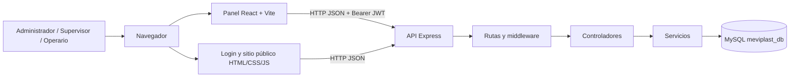

# Arquitectura

## Vista de contexto

En desarrollo, Vite sirve el panel y proxifica `/api` al puerto `PORT` de `backend/.env` (por defecto 3000). En ejecución compilada, Vite genera `frontend/dist` y Express sirve primero el build y luego el resto de archivos estáticos.

## Capas

- `backend/src/routes`: endpoints y middleware de rol.
- `backend/src/controllers`: validación HTTP y respuestas.
- `backend/src/services`: consultas y reglas del dominio.
- `backend/src/config`: conexión e inicialización de MySQL.
- `frontend/src`: aplicación React y vistas por perfil.
- `frontend/js`: scripts del login y del sitio público estático.

## Decisiones relacionadas

La unificación del panel y la conservación temporal del login/sitio público está registrada en [`../adr/ADR-001-panel-react.md`](../adr/ADR-001-panel-react.md). Este diagrama describe el código del repositorio, no un despliegue productivo verificado.
