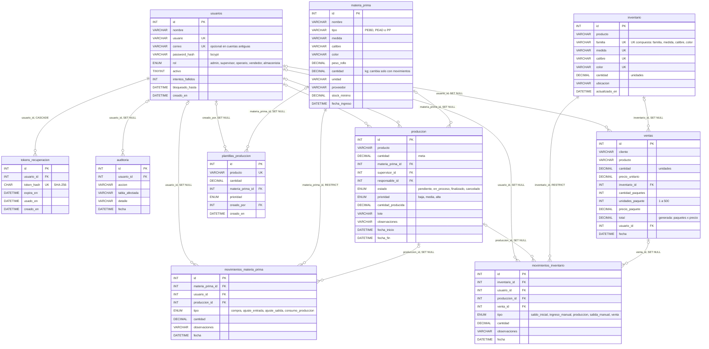

# Diagrama entidad-relación

Fuente: [`../../backend/sql/schema.sql`](../../backend/sql/schema.sql). GitHub dibuja el diagrama a partir del bloque Mermaid; para editarlo se modifica el texto. La prueba `backend/tests/er.test.js` falla si `schema.sql` tiene una tabla o una clave foránea que no aparece aquí.

Notación: `PK` clave primaria, `FK` clave foránea, `UK` valor único. `||` exactamente uno, `|o` cero o uno (la clave foránea admite NULL), `o{` cero o muchos. La etiqueta de cada relación es la columna de la clave foránea y su regla al borrar.

## Lectura rápida

- **Ledgers (ADR-003):** cada cambio de `materia_prima.cantidad` o `inventario.cantidad` deja una fila en su tabla de movimientos, en la misma transacción. Con `RESTRICT` no se puede borrar una bobina o variante que tenga movimientos.
- **Trazabilidad:** un consumo de bobina apunta a su orden (`produccion_id`); un avance de producción y una venta apuntan a su orden o venta en `movimientos_inventario`.
- **Usuarios:** al borrar un usuario, su historial se conserva con `usuario_id` en NULL; por eso se recomienda desactivarlo en lugar de borrarlo.
